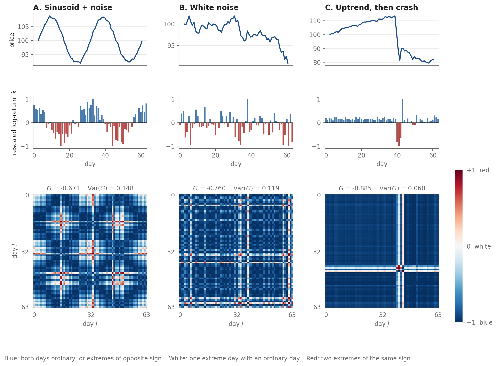

# Gramian Angular Fields as Financial Regime Detectors

Python code to encode financial time series as images using **Gramian Angular Fields (GAF)** (Wang & Oates, 2015), and to reproduce the figures of the report and digest on the **1929 Wall Street Crash**.



## Overview

A GAF turns a window of a time series into an $n \times n$ image in which every pixel compares two days of the window. The code applies this to daily log-returns of the Dow Jones Industrial Average (DJI) and asks:

> Does the GAF representation of the DJI capture structural changes in the pre-crash bubble period compared with the post-crash crisis period?

The repository contains:

- **`gaf_encoding.py`**: the core GAF functions (rescaling, polar encoding, GAF matrix, descriptors, sliding windows).
- **`gaf_synthetic_examples.py`**: three synthetic examples (sinusoid + noise, white noise, uptrend then crash) that show how to read the colours of a GAF.
- **`dji_gaf_analysis.py`**: the full DJI analysis (Figs. 1–6 of the report).

All code is written as documented functions, with no classes.

## Quick Start

### Installation

```bash
git clone https://github.com/MAValle/gaf-financial-regimes.git
cd gaf-financial-regimes
pip install -r requirements.txt
```

Python 3.10 or newer is required.

### Synthetic examples (no data needed)

```bash
python gaf_synthetic_examples.py                  # GAF of log-returns (default)
python gaf_synthetic_examples.py --encode levels  # GAF of the price itself, for comparison
```

These commands write `figures/gaf_synthetic_returns.png` (shown above) and `figures/gaf_synthetic_levels.png`, and print $\bar{G}$ and $\text{Var}(G)$ for each case:

| Case | $\bar{G}$ | $\text{Var}(G)$ |
|---|---|---|
| A. Sinusoid + noise | −0.671 | 0.148 |
| B. White noise | −0.760 | 0.119 |
| C. Uptrend, then crash | −0.885 | 0.060 |

### DJI 1929 analysis

Place the data file in `data/` (see [Data](#data)) and run:

```bash
python dji_gaf_analysis.py --data data/dji_sp_1900_2026.csv
```

All figures are saved in `figures/`. Window size, stride and critical date can be changed with `--n`, `--m` and `--tc`.

### Using the functions directly

```python
import numpy as np
from gaf_encoding import time_series_to_gaf

returns = np.random.default_rng(0).normal(0, 0.01, 64)
res = time_series_to_gaf(returns)

print(res["gaf"].shape)                # (64, 64)
print(res["g_avg"], res["g_var"])      # scalar descriptors
```

## Method

**1. Rescaling** of each window to $[-1, 1]$:

$$\tilde{x}_i = \frac{(x_i - \max X) + (x_i - \min X)}{\max X - \min X}$$

**2. Polar encoding:**

$$\phi_i = \arccos(\tilde{x}_i) \in [0, \pi], \qquad r_i = t_i / N$$

**3. Gramian Angular (Summation) Field:**

$$G_{ij} = \cos(\phi_i + \phi_j)$$

**4. Scalar descriptors** of each window:

$$\bar{G} = \frac{1}{n^2}\sum_{i,j} G_{ij}, \qquad \text{Var}(G) = \frac{1}{n^2}\sum_{i,j}(G_{ij} - \bar{G})^2$$

For the DJI the GAF is computed on **log-returns** $r_t = \log(P_t / P_{t-1})$, and each window is **rescaled independently**. This makes the image sensitive to short-range dynamics, but the absolute price level and the slow trend are lost.

### Reading the colours (`RdBu_r`, fixed range $[-1, 1]$)

| Colour | $G_{ij}$ | Angular condition | Meaning for rescaled returns |
|---|---|---|---|
| Deep blue | ≈ −1 | $\phi_i + \phi_j \approx \pi$ | Both days ordinary (returns near zero), **or** two extremes of opposite sign |
| White | ≈ 0 | $\phi_i + \phi_j \approx \pi/2$ or $3\pi/2$ | One extreme day paired with an ordinary day |
| Deep red | ≈ +1 | $\phi_i + \phi_j \approx 0$ or $2\pi$ | Two extremes of the **same** sign |

Time runs from the top-left to the bottom-right corner. A single extreme day draws a white cross across its row and column.

**Caveat.** Colours are relative to each window's own minimum and maximum. A few extreme days set the scale and push every other day towards $\tilde{x} \approx 0$, which turns the image blue and lowers $\text{Var}(G)$. Synthetic case C shows this.

## Parameters

| Parameter | Default | Meaning |
|---|---|---|
| `n` | 64 | Window length in trading days (GAF is $n \times n$) |
| `m` | 32 | Stride between windows; consecutive windows overlap by $n - m$ days |
| `tc` | 1929-09-03 | Critical date (pre-crash peak, DJI = 381.17) |
| `seed` | 7 | Random seed for the synthetic examples |

## Figures and date conventions

| File | Content | Date shown |
|---|---|---|
| `fig1_dji_1921_1932.png`, `fig1b_…` | DJI level and log-returns, 1921–1932 | — |
| `fig2_gaf_grid_1922_1932.png` | 30 GAFs evenly spaced over 1922–1932 | window **start** |
| `fig3_gafs_before_tc.png` | 12 windows before the critical window | window **end** |
| `fig4_gafs_after_tc.png` | Critical window and the 11 after it | window **end** |
| `fig5_gavg_gvar_series.png` | $\bar{G}$ and $\text{Var}(G)$, full sample and 1920–1940 zoom | window **start** |
| `fig6_gaf_with_returns.png` | Selected GAFs next to their returns | **start → end** |
| `gaf_synthetic_*.png` | Synthetic examples | — |

The critical window is the one whose **end** date is closest to `tc`.

## File Structure

```
.
├── gaf_encoding.py            # Core GAF functions and sliding-window pipeline
├── dji_gaf_analysis.py        # DJI analysis: reproduces Figs. 1–6
├── gaf_synthetic_examples.py  # Synthetic examples for reading GAF colours
├── data/
│   └── README.md              # Expected format of the DJI file
├── figures/                   # Output figures
├── requirements.txt
├── LICENSE
└── README.md
```

## Data

`dji_gaf_analysis.py` expects a CSV with at least these columns:

| Column | Format | Example |
|---|---|---|
| `Date` | `MM/DD/YYYY` | `09/03/1929` |
| `DJI` | DJI daily closing value | `381.17` |

Row order does not matter (the script sorts by date), and stray spaces in column names are removed. See [`data/README.md`](data/README.md).

## Citation

If you use this code in research, please cite:

```bibtex
@software{Valle_GAF,
  author = {Mauricio A. Valle},
  title  = {Gramian Angular Fields as Financial Regime Detectors},
  url    = {https://github.com/MAValle/gaf-financial-regimes},
  version = {1.0},
  year   = {2026}
}
```

## Acknowledgements

Part of this work was developed with Camila Belén (FIC-UAI) in the undergraduate *Taller de Investigación Dirigida* (TID).

## References

- **Wang, Z. & Oates, T. (2015).** Encoding time series as images for visual inspection and classification using tiled convolutional neural networks. *AAAI Workshop on Neural Networks for Time Series Analysis.*
- **Scheffer, M. et al. (2009).** Early-warning signals for critical transitions. *Nature*, 461, 53–59.
- **Bury, T. M. et al. (2021).** Deep learning for early warning signals of tipping points. *PNAS*, 118(39), e2106140118.
- **Bornholdt, S. (2001).** Expectation bubbles in a spin model of markets: Intermittency from frustration across scales. *Int. J. Mod. Phys. C*, 12(5), 667–674. Implementation: [bornholdt-spin-model](https://github.com/MAValle/bornholdt-spin-model).

## License

MIT License. Free for academic and commercial use.

---

**Python 3.10+** | **NumPy, pandas, Matplotlib**
